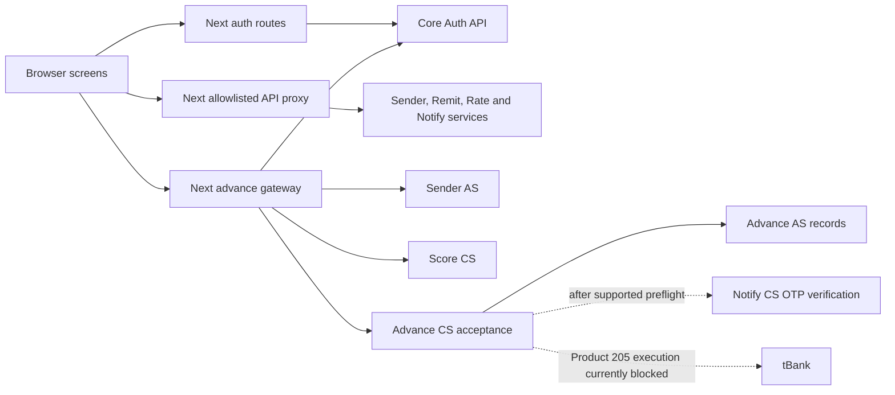

# Architecture

## Scope

This repository contains the RemitEase Next.js frontend and its server-side API
routes. OutSystems modules implement authentication and business operations;
tBank and SMULab provide external banking, contact, notification and messaging
services. Their entities and action flows are maintained outside this repository.

The current frontend uses Next.js 16 App Router, React 19, JavaScript and Tailwind
CSS 4. Exact versions are in [package.json](../package.json) and its lockfile.

## Request boundaries

The browser calls same-origin `/api/...` routes. Backend URLs, internal service
keys and bank credentials belong on the server. The proxy exposes specific
routes rather than accepting arbitrary upstream URLs.

## Code map

| Location | Responsibility |
| --- | --- |
| `app/layout.js`, `app/globals.css` | Root document, shared background and typography |
| `app/(app)/` | Home, family, remittance, rates, notifications and advance pages |
| `app/(public)/signup/`, `app/login/` | Registration and login screens |
| `app/api/auth/` | Login, current identity and logout |
| `app/api/[...path]/route.js` | Shared allowlisted backend proxy and response transformations |
| `app/api/advance/[...path]/route.js` | P6 route adapter and server configuration |
| `lib/server/advanceGateway.mjs` | P6 identity checks, routing, origin protection and response preservation |
| `lib/p1Api.js` through `lib/p4Api.js`, `lib/p6Api.js` | Browser API helpers |
| `lib/advanceState.mjs`, `lib/loginReturn.mjs` | Advance display states and safe login return destinations |
| `components/OtpDialog.jsx` | Shared SMS challenge and confirmation interaction |
| `lib/mock/`, `app/api/mock/` | Development fixtures and mock handlers |
| `tests/p6-gateway.test.mjs`, `tests/browser/` | Controlled-provider checks and Playwright browser tests |
| `infra/rabbitmq/` | Optional local broker and tunnel for notification integration |

Route groups such as `(app)` organize source files without adding URL segments.
Pages currently own their layouts; the root document is a minimal shared shell.

## Service responsibilities

| Area | Backend responsibility |
| --- | --- |
| P1 Sender | Sender-to-Party and bank-account mappings, onboarding and beneficiaries |
| P2 Remit | Remittance quote, confirmation and transfer orchestration |
| P3 Notify | OTP challenges, verification, inbox and notification delivery |
| P4 Rate | Rate locks and alerts |
| P5 Core / Score | Authentication, shared configuration and eligibility snapshots |
| P6 Advance | A8 advance/repayment records, C9 acceptance and C10 collection |

Frontend ownership is coordinated by these areas. Shared auth/proxy changes
need review from their maintainer; changes to the shared OTP dialog affect
multiple confirmation flows.

## Authentication and identifiers

Login forwards credentials to Core from a server route. A successful response
sets the `remitease_session` cookie with `httpOnly`, `sameSite=lax`, an eight-hour
maximum age and `secure` in production. The browser receives an authenticated
result rather than the backend token. API handlers read the cookie and attach
the backend's supported authentication headers.

P6 validates `/Auth/me` before routing an authenticated request. Eligibility uses
that validated user and the Sender service's bank mapping. Browser-supplied user
IDs, account IDs and service keys do not establish the borrower.

| Identifier | Meaning |
| --- | --- |
| `UserId` | Authenticated OutSystems user |
| `PartyId` | SMULab contact/profile identifier |
| `tBankCustomerId` | Bank customer identifier |
| `sgdAccountId` | Worker deposit account |
| Loan account ID | Separate loan account created by the bank |
| Snapshot ID | Eligibility snapshot checked by the backend |
| Request key | Stable idempotency and recovery reference for one acceptance intent |

P1 onboarding intentionally supplies the UserId as the Party's external ID, so
the values may match. A matching number is not itself an error: the Party profile
must exist and belong to that worker. Preserve leading zeros in bank identifiers.

## Advance routes and entry points

Home links to `/advance/accept`. An offer screen can prefill `amount`, `months`
and optional `snapshotId` query parameters; the backend revalidates all of them.
An existing `requestKey` instead resumes that request's status recovery. The
acceptance screen does not replace the offer or My Advance dashboard.

P5 owns `/advance/offer` and `/advance/me`, now included from the P5 branch.
The offer page hands its query parameters to `/advance/confirm`, a P6 entry point
that reuses `/advance/accept`. P6 supports a direct Home entry and the query
parameters above so its acceptance page can be checked independently. P6's
gateway currently accepts terms of 1–6 months; P5's 12-month selection cannot be
confirmed through that gateway. Automatic
sending of an advance to a beneficiary is deferred from this P6 scope; the
gateway rejects a nonzero `sendToBeneficiaryLinkId`. Adding it later would need
a trusted C9/P2 continuation. The existing Send screen remains a separate flow.

| Local route | Backend |
| --- | --- |
| GET `/api/advance/eligibility?amount=&months=&snapshotId=` | Core `/Auth/me`, protected Sender lookup and Score CS eligibility |
| POST `/api/advance/acceptances` | C9 AdvanceAccept `/advances`, with `Idempotency-Key` |
| GET `/api/advance/operations/by-request/{key}` | C9 owner-scoped status |
| POST `/api/advance/operations/{id}/cancel` | C9 owner/version-checked cancellation |

The collector endpoint is not exposed through this browser gateway. P6 uses real
services even when shared development mock mode is enabled.

## Advance confirmation and recovery

1. The gateway validates the session, resolves the worker's bank mapping and
   retrieves a real eligibility offer.
2. The user reviews returned terms. When confirmation is enabled, the shared
   dialog requests a real `ADVANCE` challenge bound to the snapshot.
3. One acceptance intent uses one request key. C9 owns authorization, preflight,
   OTP verification, journal transitions and any eventual bank execution.
4. Errors retain operation IDs and versions so the owner can read status and,
   when permitted, cancel an undispatched request.

Only the non-secret request reference is persisted in session storage and the
URL; passwords, bearer tokens and OTP codes are not stored there. The UI shows
cancellation only for a `RECEIVED` operation with an ID and version and no
reconciliation flag. C9 enforces the final authorization and state transition.

The P6 gateway preserves C9's error data on 409/503 responses. This differs from
the shared proxy's generic error normalization. Do not replace the P6 adapter
with an error wrapper that drops the operation ID, version or recovery state.

The P6 browser helper accepts a successful operation response only when it has
a nonempty status, positive operation ID and positive version. Malformed
acceptance, status or cancellation responses retain the request reference and
keep the screen in recovery. Cancellation errors adopt a valid returned
operation, including newer versions and reconciliation flags; an unknown
cancellation outcome requires a status check before another cancellation.
`NOT_SUBMITTED` is a local display state and is rejected in backend operation
responses; only the proxy's explicit non-forwarding proof can permit it.

A proxy rejection before a new C9 POST can explicitly attest
`requestNotForwarded=true`. Only a first attempt with that proof may release its
local reference. Unknown network outcomes, backend errors, previous attempts and
404 status reads retain the reference. Financial POSTs are never blindly retried.

The server-configured `P6_FRONTEND_ORIGIN` handles a browser origin that differs
from Next's internal URL. Other origins remain rejected; browser inputs and
forwarded-host headers cannot change the allowed origin.

## Current banking boundary

As verified on 7 November 2026, Product 205 preflight returns
`INTEREST_REPAYMENT_CONTRACT_PENDING` before C9 OTP verification or bank loan
creation. A passing blocked-response test is not proof of funded borrowing.

The inspected active C10 payment path requires zero interest. Product 205's
principal/interest helpers are not yet connected to that dispatch path. Funding
evidence, due-period interest handling and final settlement need verification
before automatic payments can be activated. The browser exposes no collector
endpoint. The frontend confirmation flag does not bypass backend safeguards.
