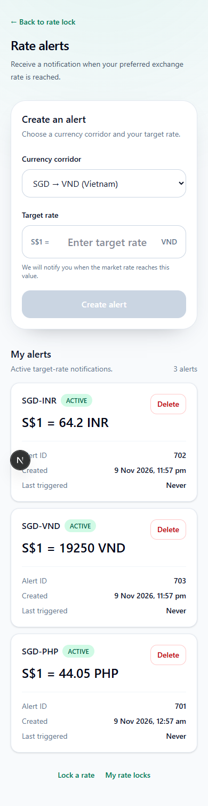
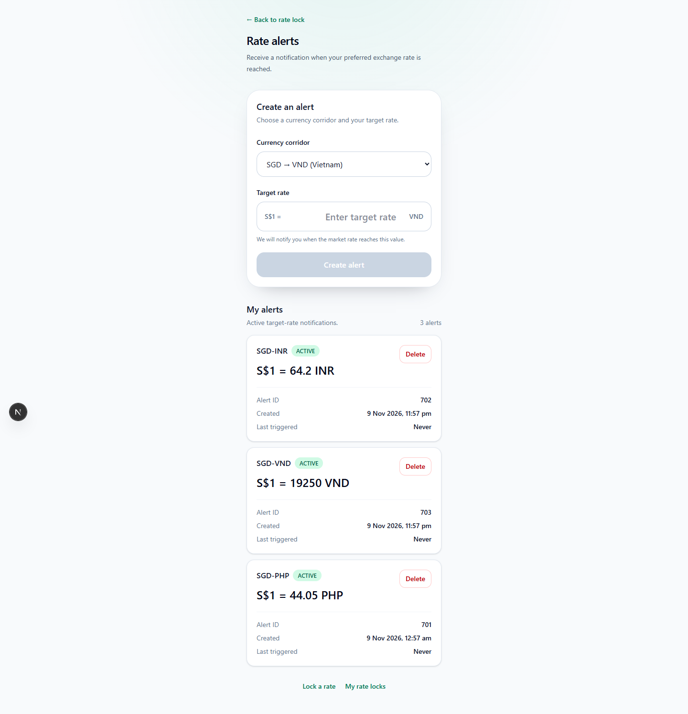
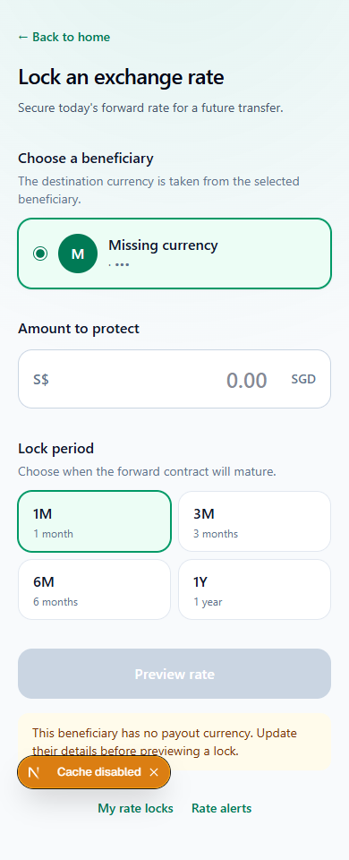

# P4 currency corridors — frontend review

This branch changes the frontend and development mocks only. OutSystems modules
have not been edited or published. Do not interpret mock forward contracts as
proof of live bank support.

## Step 0 evidence

Checks supplied by the team on 10 November 2026 (Singapore time):

| SGD quote currency | SMULab spot | tBank currency list | Forward 1M / 3M / 6M / 1Y | Contract account requirement |
| --- | --- | --- | --- | --- |
| PHP | HTTP 200, 49.315 | Present | All HTTP 400 | Unverified |
| INR | Rate returned | Present | All HTTP 400 | Unverified |
| BDT | Rate returned | Present | All HTTP 400 | Unverified |
| IDR | Rate returned | Present | All HTTP 400 | Unverified |
| MYR | Rate returned | Present | All HTTP 400 | Unverified |
| MMK | Rate returned | Present | All HTTP 400 | Unverified |
| VND | Rate returned | Present | All HTTP 400 | Unverified |

PHP 1M and all INR periods explicitly returned `Record not found`; the other
failures were reported as HTTP 400 without individual response bodies. Controls
USD/GBP 1M and SGD/USD 1M returned rates. USD/PHP 1M also returned `Record not found`.
The pair-configuration lookup returned HTTP 403: service unavailable to the
current subscription. The user authorized proceeding without further blocked checks.

The inspected existing lock maps `GetBeneficiary.Response.Data.AccountId` to
`DestinationAccountId`, then `OpenContractRequest.QuoteCurrencyAccountID`.
Its quote currency is `BeneficiaryCurrency`. Bank ownership/currency requirements
for that account remain unverified. No bank configuration or contract was changed.

## Frontend behavior

- `lib/corridors.js` contains the seven verified spot corridors. Membership does
  not assert forward-rate availability.
- Alerts select a corridor, preserve positive target-rate precision, display the
  alert's own currency and hide inactive rows returned by older backends.
- Lock screens use beneficiary payout currency and show an explanation when it
  is missing or unsupported. Preview requires a finite positive forward rate,
  positive recipient amount and a valid maturity date before OTP confirmation.
- Money uses the existing `formatMoney`; exchange-rate ratios retain their own
  precision instead of being rounded to currency minor units.
- The user approved removing the shared proxy's invented payout-currency fallback.
  Other shared proxy behavior is unchanged.
- Development fixtures add India and Vietnam beneficiaries and per-currency
  quotes. PHP mock forward values are preserved. Fixtures are fictional and
  remain behind the existing non-production mock gate.

## Backend work still required

In Rate AS/CS, add the shared Corridor entity/list, enforce corridor and positive
rate validation, return only active alerts while preserving the creation ID,
fetch spot rates per distinct active corridor with isolated failure handling,
and emit currency-specific RATE_ALERT/LOCK text without changing event contracts.
Validate the beneficiary-derived currency and bank quote in preview and creation.
These server-side guarantees cannot be supplied by frontend filtering or mocks.
Live new-currency lock acceptance remains blocked by the observed bank failures.

## Running checks

`node node_modules/@playwright/test/cli.js test --config playwright.p4.config.mjs`
starts an isolated local mock preview and checks all seven alert corridors,
PHP/INR/VND mock quotes, OTP binding, INR confirmation, inactive alert filtering,
invalid quote rejection, and desktop/phone layout. No live API or bank writes.

The existing P5/P6 controlled-provider tests and production build are also run
before committing. Bun is not installed in this environment, so commands use
the installed Node runtime directly; the Bun-specific environment test cannot run.

## Rollback

Revert this frontend commit. It makes no persisted schema changes. Restart the
development server to reset in-memory mock fixtures. Backend rollout is separate.

### Windows external-preview fallback

If the test runner hangs during child-server shutdown, run a dedicated mock
preview in a separate terminal, then point the tests at it:

```powershell
$env:P6_E2E_BUILD='1'
$env:NEXT_PUBLIC_USE_MOCK_API='true'
node node_modules/next/dist/bin/next dev --webpack --hostname 127.0.0.1 --port 3095
```

In a second terminal:

```powershell
$env:P4_E2E_BASE_URL='http://127.0.0.1:3095'
node node_modules/@playwright/test/cli.js test --config playwright.p4.config.mjs
```

Stop the preview with Ctrl+C after testing. The external preview option only
accepts this loopback URL. Eight P4 tests passed using this mode, including discarding a pending quote when the beneficiary changes.

### Visual evidence (fictional development fixtures)





## Validation results

- ESLint: passed.
- P4 browser/API suite: 8 passed (mock-only).
- Existing P5/P6 Node suites: 61 passed.
- Production build: passed in an isolated source copy with the existing installed
  dependencies. Windows raised intermittent EPERM errors creating generated
  directories; a temporary external Node preload retried only mkdir EPERM errors.
  No repository build configuration or dependency was changed for this workaround.
- Existing P5/P6 production-browser smoke suite: not run this turn. Execution
  policy blocked starting the local production preview, including after a
  directory/network permission request. Run this suite in CI or the normal
  developer environment before merging.
- Bun environment suite: not run because Bun is not installed.
- No live bank contracts, OutSystems changes, or backend end-to-end claims.